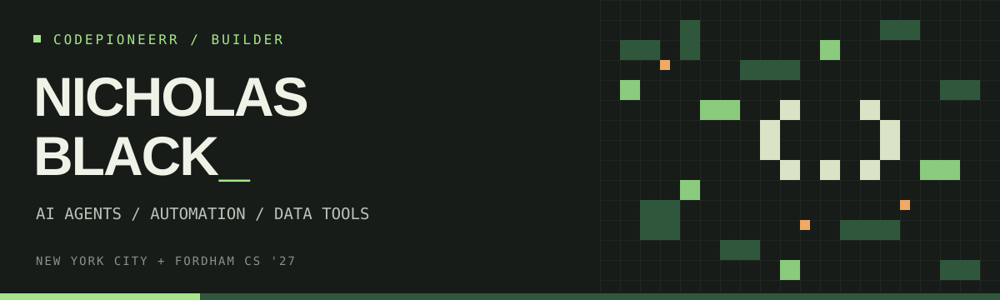

  

  <a href="https://www.linkedin.com/in/nicholas-black-0a44a4245/">LinkedIn</a> &nbsp; / &nbsp;
  <a href="https://github.com/codepioneerr?tab=repositories">Projects</a> &nbsp; / &nbsp;
  <a href="https://youragentcode.com/">Your Agent Code</a>

### Who am I

I'm Nick — **Fordham University CS ’27** and **EndPoint Services Assistant at Fordham IT**. I build AI agents, automation, and data tools at **Your Agent Code**.

At Fordham: Dean’s List · Quant Trading Club Marketing Manager · Computer Science Club.

### Selected builds

- **[Spine](https://github.com/codepioneerr/spine)** — self-hosted Python automation with scheduled jobs, model routing, and privacy and spend controls.
- **[Real Estate Market Dashboard](https://github.com/codepioneerr/real-estate-market-dashboard)** — rent analytics and forecasting with Python, SQL, and Streamlit.

**Stack:** Python · JavaScript · SQL · React · FastAPI · pandas · Docker · GitHub Actions

**Offline:** street photography, car building and tuning, combat sports.
